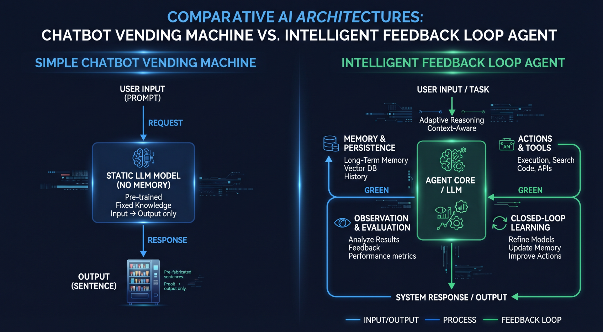

# The Long-Term Advantages of Agentic AI — and Why You Shouldn't Fear It

## 1. What Agentic AI Actually Is (vs. a Chatbot)

A chatbot answers questions. You type, it replies, and when the conversation ends, it forgets you exist. It's a vending machine for sentences.

An **agent** is different in four ways that matter:

- **It remembers.** It holds your context across days and months — your courses, your budget rules, your deadlines. A chatbot starts from zero every time. An agent starts from *you*.
- **It acts.** It doesn't just suggest a reminder — it sets one. It doesn't describe a dashboard — it updates it. It drafts, files, tracks, and checks.
- **It persists.** An agent works on a schedule and across time: a morning briefing, a weekly check-in, a nudge before a renewal hits. It carries threads you'd otherwise have to hold in your head.
- **It closes loops.** A chatbot gives you a plan. An agent asks whether the plan happened, logs the receipt, and notices when Monday's call quietly becomes Thursday's call.

That last one is the whole game. Most people don't fail for lack of information. They fail in the gap between intention and execution. Agents live in that gap.

## 2. The Long-Term Advantages

### Time arbitrage

Your scarcest resource isn't money — it's hours. Run multiple courses, daily content, a portfolio build, and an admin backlog on one brain and the math is obvious. Every reminder you don't have to remember, every deadline an agent surfaces before it bites, every draft it produces while you sleep is an hour returned to the work only you can do: learning, lifting, filming, thinking.

Over a semester, that's not minutes. That's weeks.

### Persistent memory and continuity

Human memory leaks. A call you meant to make Monday slips to Thursday because nothing was holding the thread but you. An agent's memory doesn't leak. It knows your targets, which assignment is due when, and which admin problem you're actually solving this week. That continuity is what turns scattered effort into a *system* — the left hand always knows what the right hand promised.

### Execution partnership: intentions become receipts

This is the advantage nobody markets because it isn't glamorous: **an agent turns "I should" into a tracked record.** Your non-negotiables get logged. Your progress gets recorded. When you say a thing is done, there's a receipt — and when it isn't done, the gap is visible instead of deniable.

That visibility is uncomfortable and it's gold. It's how a few tracked steps can turn a months-long "this admin problem feels impossible" fog into a single, manageable task.

### Compounding systems

One reminder is nothing. A year of morning briefings, closed loops, logged workouts, and updated ledgers is a *flywheel*. Each system you build with an agent — study rhythm, financial splits, content cadence — keeps running without willpower. Willpower is a daily budget. Systems are infrastructure. The long-term winners aren't the most motivated people; they're the ones whose good behavior runs on rails.

### Leverage for a one-person operation

A one-person media company, a full-time student, and an aspiring security professional are three jobs. Corporations solve that with staff: assistants, bookkeepers, producers, project managers. An agent gives a single person a poor-man's version of that staff. You direct; it carries. That's not a convenience — it's how one person competes in lanes that used to require a team.

## 3. Why You Shouldn't Fear It — and the Honest Risks

### Agency stays with the human

An agent proposes; you dispose. It can set a reminder to cancel a subscription — *you* cancel it. It can outline your options on a financial decision — *you* make the call. The moment an agent's output becomes your decision without your judgment in between, that's not the technology failing. That's a habit to refuse. Keep the human on the decisions that touch money, reputation, and other people, and the tool stays a tool.

### Tool, not replacement

A calculator didn't replace mathematicians; it replaced arithmetic drudgery and freed them for harder math. Agents do the same for cognitive drudgery — scheduling, tracking, first drafts, recall. The skills that make you valuable in AI security — judgment under uncertainty, adversarial thinking, understanding systems deeply enough to break them — are precisely the ones an agent can't do *for* you. It can only clear the brush so you can do them more.

### The real risks, stated plainly

- **Over-reliance.** If the agent vanished tomorrow, could you still run your week? Keep your core systems understandable to you — the agent holds the ledger, but you should always be able to read it.
- **Skill atrophy.** If it writes everything, your writing rots. If it does every calculation, your number sense dulls. *Management:* let it draft, check, and organize — but you do the reps that build the skill you're trying to own.
- **Privacy.** An agent that knows your finances, health admin, and schedule is holding sensitive material. *Management:* keep your separate brands and projects separate, don't hand it credentials it doesn't need, and treat its memory like a notebook you'd notice missing.
- **Confident errors.** Agents can be wrong while sounding certain — a misremembered date, a plausible-but-false detail. *Management:* verify anything that would cost you money, a grade, or a relationship. Trust the system, spot-check the facts.

None of these are reasons to avoid the tool. They're operating instructions.

## 4. How People Who Win With Agents Actually Use Them

- **They delegate outcomes, not vibes.** "Remind me on the 2nd to order supplements" beats "help me be healthier." Specific task, specific date, checkable result.
- **They build routines, not one-offs.** The daily checklist, the morning briefing, the weekly check-in — recurring structure is where the compounding lives.
- **They keep a single source of truth.** One dashboard, one ledger, one checklist. When the agent and your head disagree, the written record wins — and gets corrected if it's wrong.
- **They verify the big things.** Receipts for money, submissions for school, confirmations for anything irreversible. Trust is earned per-category, not granted globally.
- **They review and prune.** Systems accumulate cruft — stale reminders, dead goals, a nudge for a task that no longer exists. Winners clean house. Losers let the system get noisy until they stop listening to it.
- **They keep judgment human.** Strategy, taste, relationships, ethics, the call on whether to take a project — those stay with the person. The agent informs them; it doesn't make them.

## 5. The Three-Phase Evolution of Adopting Agentic Workflows

**Phase 1 — Operational Baseline:** The agent serves as a personal continuity layer to stabilize basic execution. It prevents dropped threads across administrative backlogs, course deadlines, and daily output. The core win condition here is not complex automation, but reliable follow-through and zero forgotten tasks.

**Phase 2 — Systems Orchestration:** As technical projects, professional commitments, and portfolio demands scale, the agent shifts into an operations manager. Instead of juggling disparate notebooks, dashboards, and calendars, workstreams are coordinated in a unified system. Consistent, protected output slots yield a steady accumulation of work—turning routine effort into documented repositories and visible proof of skill.

**Phase 3 — Systems Intuition and Domain Leverage:** For technical practitioners, especially those working in systems architecture, cybersecurity, and AI alignment, directing an agent becomes practical field training. Regularly scoping tasks, auditing model outputs, identifying confident hallucinations, and hardening human-in-the-loop controls builds direct operational intuition for how agentic architectures behave under real-world conditions. 

The fear question, answered plainly: the real risk lies in delegating critical judgment and abandoning deliberate practice. Keeping human verification at the core, maintaining an independent source of truth, and using agents as leverage rather than a crutch is how individual operators achieve the compound output of an entire team.
